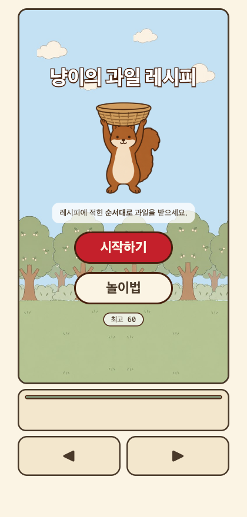
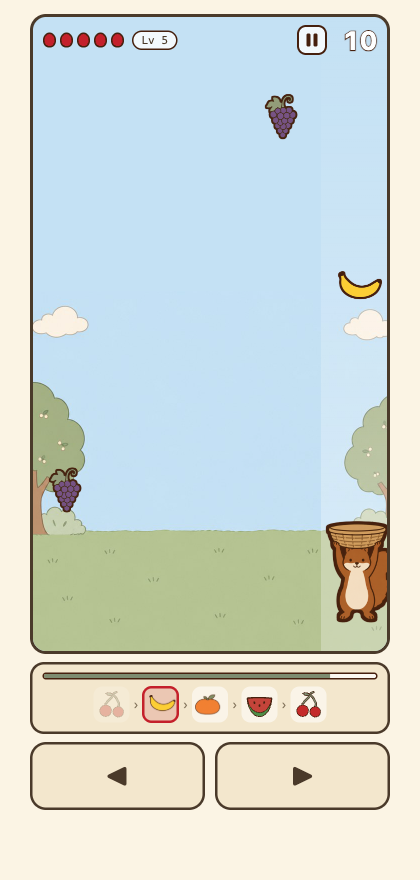
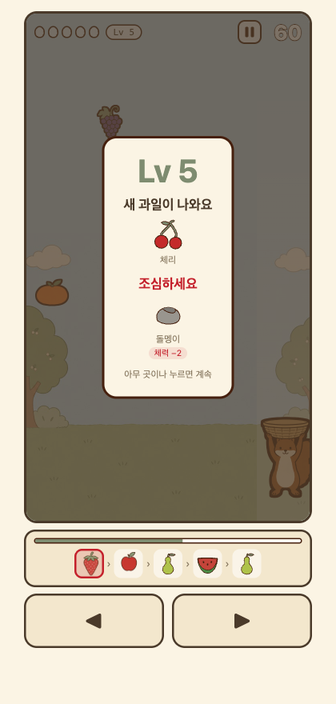
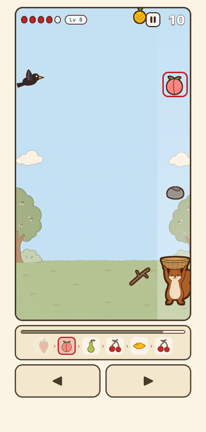

# mini-games

개인 프로젝트로 만드는 웹 미니 게임 모음입니다. **게임 하나 = 폴더 하나 = 독립 빌드**로,
루트에는 의존성을 두지 않습니다.

| 폴더 | 게임 | 플레이 |
|---|---|---|
| [`dotori-basket/`](dotori-basket) | 냥이의 과일 레시피 | [mini-games.kwonyj.workers.dev](https://mini-games.kwonyj.workers.dev) |

---

# 🍎 냥이의 과일 레시피

레시피에 적힌 **순서대로** 떨어지는 과일을 받는 게임입니다.
순서가 아닌 과일을 받거나 방해물에 맞으면 체력이 깎이고, 다 닳으면 끝납니다.

<p align="center">
  
  
</p>

## 어떻게 하는 게임인가

화면 아래 **레시피 바**의 빨간 칸이 지금 받아야 할 과일입니다. 왼쪽부터 차례로 채웁니다.
좌우 버튼이나 방향키로 바구니를 옮겨 그 과일만 골라 받습니다.

| | |
|---|---|
| 레인 | 5개 · 세로 360 × 640 (웹뷰 탑재 전제) |
| 체력 | 5칸. 오답 과일 −1, 돌멩이 −2 |
| 제한시간 | 레시피당 30초. 다 쓰면 체력이 깎이고 레시피가 새로 나옵니다 |
| 레벨업 | 레시피 5개 완성마다 +1. 과일이 해금되고 낙하 속도가 빨라집니다 |
| 아이템 | 과일 15종 + 방해물 2종 + 까마귀 |

레벨이 오를 때마다 무엇이 새로 나오는지 알려줍니다. 방해물은 **무엇을 잃는지**까지 함께 적습니다.
죽고 나서야 돌멩이가 체력 두 칸을 먹는다는 걸 알게 되면 늦기 때문입니다.

<p align="center">
  
  
</p>

## 방해물 설계

방해물은 **피하는 것**이지 판단하는 것이 아닙니다. 레시피를 볼 필요 없이 한눈에 피할 수 있어야
밀도는 올라가되 판단 부담은 그대로입니다. 그래서 과일과 실루엣이 겹치지 않게 그렸고,
썩은 과일처럼 "골라내야 하는" 방해물은 의도적으로 넣지 않았습니다.

셋 다 정답 행동은 "피한다"로 같고, 차이는 실패했을 때만 드러납니다.

| | 받으면 | 해금 |
|---|---|---|
| 🪵 나뭇가지 | 콤보만 끊깁니다. 체력은 그대로입니다 | Lv3 |
| 🪨 돌멩이 | 체력 −2 | Lv5 |
| 🐦‍⬛ 까마귀 | **받는 물건이 아닙니다.** 날아와서 화면의 과일을 먹어치웁니다 | Lv8 |

까마귀는 낙하물이 아니라 이벤트입니다. 1초 예고 동안 노린 과일에 표식이 붙으므로,
**빼앗기기 전에 먼저 받는** 선택지가 생깁니다. 예고가 없으면 개입할 수 없는 손실일 뿐입니다.

## 기술

- **Next.js 16 App Router** · `output: 'export'` 정적 빌드 · React 19 · TypeScript
- **Cloudflare Workers** 정적 자산 배포. SSR 어댑터를 쓰지 않습니다
- 게임 루프는 **고정 타임스텝 1/60 + 누적기**. 낙하물은 DOM 노드 풀로 재사용합니다
- 60fps로 변하는 값은 React state에 두지 않습니다. ref와 직접 DOM 조작으로 처리합니다
- 규칙 로직(`game/`)은 React를 import하지 않습니다. Vitest로 **99개 테스트**가 붙어 있습니다

### 구조

```
dotori-basket/
├── game/          ★ React 무관 순수 규칙. 테스트가 여기 붙는다
│   ├── config/      밸런스 수치의 유일한 출처
│   └── systems/     스포너 · 레시피 · 점수 · HP · 까마귀
├── hooks/         React와 게임을 잇는 배선. JSX를 두지 않는다
├── components/    마크업과 스타일만
└── docs/          규칙 · 설계 · 결정 이력 (43개 문서)
```

세 층으로 나눈 이유와 경계는 [`docs/arch/components.md`](dotori-basket/docs/arch/components.md)에 있습니다.

## 실행

```bash
cd dotori-basket
npm install
npm run dev          # http://localhost:3000
```

```bash
npm run build        # 정적 빌드 → out/
npm run preview      # 빌드 후 Cloudflare 런타임으로 로컬 확인
npm test             # Vitest
npm run typecheck
```

개발 중에는 `?dbg` 쿼리로 디버그 훅이 열립니다. 레벨업까지 손으로 가는 비용이 커서 넣어 뒀습니다.

```js
__dbg.jump(8)    // 해당 레벨로 점프
__dbg.crow()     // 까마귀를 지금 부른다 (주기가 14초라 기다릴 수 없다)
__dbg.state()    // 현재 상태
```

## 문서

설계 근거와 결정 이력을 코드와 함께 관리합니다. 지도는
[`dotori-basket/docs/README.md`](dotori-basket/docs/README.md)에 있습니다.

| 찾는 것 | 문서 |
|---|---|
| 게임이 무엇인가 | [`docs/concept.md`](dotori-basket/docs/concept.md) |
| 무엇이 언제 떨어지나 | [`docs/rules/spawner.md`](dotori-basket/docs/rules/spawner.md) |
| 방해물 · 까마귀 | [`docs/rules/obstacles.md`](dotori-basket/docs/rules/obstacles.md) |
| 컴포넌트 · 훅 규약 | [`docs/arch/components.md`](dotori-basket/docs/arch/components.md) |
| 왜 이렇게 됐나 | [`docs/history/`](dotori-basket/docs/history) |

깨면 게임이 망가지는 불변식은 [`dotori-basket/CLAUDE.md`](dotori-basket/CLAUDE.md)에 표로 모아
두었습니다. 각 항목에 **어기면 무슨 일이 생기는지**와 근거 문서를 함께 적었습니다.

## 라이선스

코드는 [MIT](LICENSE)입니다.

게임 아트는 두 계보가 섞여 있습니다. 과일 5종(사과·귤·바나나·딸기·포도)과 다람쥐·배경은
SpriteCook으로 생성한 뒤 다듬었고, [이용약관](https://www.spritecook.ai/terms) §6에 따라
배포합니다. 나머지 과일 10종과 방해물·까마귀는 그 생성물에서 실측한 수치로 직접 그린 SVG입니다.
확장자가 계보를 말해 줍니다. `.png`가 생성물, `.svg`가 직접 작업한 것입니다.
